# Diagrama de Clases y Matriz de Autoría — Sistema de Gestión CRAI (Universidad del Rosario)

**Integrantes del Equipo:**
- **Oscar David Alvarado Navarrete (DA)**
- **Nicolás Marín Quintero (NM)**

---

## 1. Matriz de Autoría por Módulo y Archivo

| Capa | Archivo / Módulo | Desarrollador Principal | Origen / Trazabilidad Trello y Entregas |
| :--- | :--- | :--- | :--- |
| **Estructuras Base** | `include/Estructuras/Nodo.h` | **Nicolás Marín Quintero (NM)** | Evolución de `Corte_1/listaEnlazada.cpp` (nodos genéricos con plantillas) |
| **Estructuras Base** | `include/Estructuras/VectorDinamico.h` | **Nicolás Marín Quintero (NM)** | Evolución de `VectorPropio*` + `InsertionSort`, `MergeSort`, `HeapSort` y `BusquedaBinaria` |
| **Estructuras Base** | `include/Estructuras/ListaSimple.h` | **Nicolás Marín Quintero (NM)** | Evolución de `Corte_1/listaEnlazada.cpp` (préstamos activos y listas de adyacencia) |
| **Estructuras Base** | `include/Estructuras/ListaDoble.h` | **Oscar David Alvarado Navarrete (DA)** | Evolución de `Corte1/Historial.h/.cpp` (navegación recursiva adelante/atrás) |
| **Estructuras Base** | `include/Estructuras/Pila.h` | **Nicolás Marín Quintero (NM)** | Evolución de `Corte_2/PilaPrestamosyDevoluciones.h/.cpp` (estructura LIFO) |
| **Estructuras Base** | `include/Estructuras/Cola.h` | **Nicolás Marín Quintero (NM)** | Evolución de `Corte_2/ColaListadeEspera.h/.cpp` (lista de espera FIFO) |
| **Estructuras No Lineales** | `include/Estructuras/TablaHash.h` | **Desarrollo Conjunto (DA & NM)** | Unificación de `Corte2/TablaHash` (DA) y `Corte_2/tablaHashBusquedaInmediata` (NM — Horner) |
| **Estructuras No Lineales** | `include/Estructuras/ArbolAVL.h` | **Desarrollo Conjunto (DA & NM)** | Entrega 3: índice autobalanceado en $O(\log n)$ |
| **Estructuras No Lineales** | `include/Estructuras/ArbolCategorias.h` | **Nicolás Marín Quintero (NM)** | Evolución de `Corte_2/conjuntosyMapasCategorias` hacia árbol N-ario LCRS |
| **Estructuras No Lineales** | `include/Estructuras/MatrizDisponibilidad.h` | **Oscar David Alvarado Navarrete (DA)** | Evolución de `Corte1/Disponibilidad.h/.cpp` + índice Hash O(1) y `SnapshotEstado` |
| **Estructuras No Lineales** | `include/Estructuras/GrafoSedes.h` | **Oscar David Alvarado Navarrete (DA)** | Tarjetas Trello RQF 014–016 (sedes reales CRAI, BFS con viabilidad y DFS) |
| **Dominio POO** | `include/Dominio/Recurso.h` | **Nicolás Marín Quintero (NM)** | Evolución de `POOClasesHerencia.cpp` y `ClaseRecursos.h` (`Libro`, `Computador`, `Sala`) |
| **Dominio POO** | `include/Dominio/Usuario.h` | **Nicolás Marín Quintero (NM) & Oscar David Alvarado (DA)** | Base POO de `ClaseUsuario.h` (NM) + cooldown anti fuerza bruta (DA) |
| **Seguridad y Persistencia** | `include/Seguridad/Validador.h` | **Oscar David Alvarado Navarrete (DA)** | Sanitización CSV/JSON, bloqueo de `"null"`/`"nullptr"` y parseo seguro |
| **Seguridad y Persistencia** | `include/Seguridad/CryptoHash.h` | **Oscar David Alvarado Navarrete (DA)** | Wrapper OpenSSL (`PBKDF2-HMAC-SHA256`, `RAND_bytes`, `CRYPTO_memcmp`) |
| **Seguridad y Persistencia** | `include/Servicios/AdminCSV.h` | **Oscar David Alvarado Navarrete (DA)** | Evolución de `Corte2/AdminCSV.h/.cpp` (7 archivos CSV + escritura atómica) |
| **Integración y Web** | `include/Servicios/GestorCRAI.h` | **Desarrollo Conjunto (DA & NM)** | Fachada central de los 28/29 RQF, BucketSort, Undo real y seguridad |
| **Integración y Web** | `src/main.cpp`, `web/*`, `Makefile`, CI/CD | **Oscar David Alvarado Navarrete (DA)** | Servidor REST `cpp-httplib`, CLI `--unlock`, frontend Pico.css y GitHub Actions |
| **Pruebas y Calidad** | `tests/tests_main.cpp` | **Desarrollo Conjunto (DA & NM)** | Suite unitaria normal/límite/error validada con `AddressSanitizer` |

---

## 2. Diagrama de Clases en Mermaid (Con Etiquetas de Desarrollador)

```mermaid
classDiagram
    direction TB

    namespace Estructuras_NM {
        class NodoSimple~T~ {
            <<Dev: Nicolas Marin>>
            +T dato
            +NodoSimple~T~* siguiente
        }
        class NodoDoble~T~ {
            <<Dev: Nicolas Marin>>
            +T dato
            +NodoDoble~T~* siguiente
            +NodoDoble~T~* anterior
        }
        class VectorDinamico~T~ {
            <<Dev: Nicolas Marin>>
            -T* datos
            -int tamano
            -int capacidad
            +push_back(const T&) void
            +eliminarEn(int) void
            +insertionSort(cmp) void
            +mergeSort(cmp) void
            +heapSort(cmp) void
            +busquedaBinaria(clave, cmp) int
        }
        class ListaSimple~T~ {
            <<Dev: Nicolas Marin>>
            -NodoSimple~T~* cabeza
            -NodoSimple~T~* cola
            +insertarFinal(const T&) void
            +eliminar(const T&) bool
            +eliminarSi(pred, out) bool
        }
        class Pila~T~ {
            <<Dev: Nicolas Marin>>
            -NodoSimple~T~* cima
            +push(const T&) void
            +pop(T&) bool
        }
        class Cola~T~ {
            <<Dev: Nicolas Marin>>
            -NodoSimple~T~* frente
            -NodoSimple~T~* finalCola
            +encolar(const T&) void
            +desencolar(T&) bool
        }
        class ArbolCategorias~T~ {
            <<Dev: Nicolas Marin>>
            -NodoCategoria* raiz
            +insertarSubcategoria(padre, hija) bool
            +consultarTodoBajoCategoria(cat) VectorDinamico~T~
        }
    }

    namespace Estructuras_DA_y_Conjunto {
        class ListaDoble~T~ {
            <<Dev: David Alvarado>>
            -NodoDoble~T~* head
            -NodoDoble~T~* tail
            +insertarFinal(const T&) void
            +obtenerAdelante() VectorDinamico~T~
            +obtenerAtras() VectorDinamico~T~
        }
        class TablaHash~V~ {
            <<Dev: DA y NM>>
            -NodoHash** cubetas
            -int capacidad
            -int totalColisiones
            -funcionHorner(clave) int
            +insertar(clave, val) void
            +buscar(clave, out) bool
            +eliminar(clave) bool
        }
        class ArbolAVL~K,V~ {
            <<Dev: DA y NM>>
            -NodoAVL* raiz
            +insertar(k, v) void
            +buscar(k, out) bool
            +eliminar(k) bool
            +recorridoInorden() VectorDinamico~V~
        }
        class MatrizDisponibilidad {
            <<Dev: David Alvarado>>
            -string* codigos
            -bool* matrizDisp
            -TablaHash~int~* indicePorCodigo
            +reservarTurno(cod, sede, dia) bool
            +capturarSnapshot() SnapshotEstado
            +restaurarSnapshot(snap) bool
        }
        class GrafoSedes {
            <<Dev: David Alvarado>>
            -VerticeSede* vertices
            +precargarSedesCRAI(matriz) void
            +caminoMasCortoBFS(orig, dest) VectorDinamico~string~
            +buscarSedeCercanaConRecursoBFS(orig, cod, mat, dia, maxDist) ResultadoRutaSede
            +esRedConexa() bool
        }
    }

    namespace Dominio_POO {
        class Recurso {
            <<abstract | Dev: Nicolas Marin>>
            #string codigo
            #string nombre
            #string estado
            #bool disponible
            #int sedeId
            #int vecesPrestado
            #Cola~string~ colaEspera
            #ListaDoble~RegistroHistorial~ historial
            +virtual ~Recurso()
            +virtual aJSON() string*
        }
        class Libro {
            <<Dev: Nicolas Marin>>
            -string autor
        }
        class Computador {
            <<Dev: Nicolas Marin>>
            -string sistemaOperativo
        }
        class Sala {
            <<Dev: Nicolas Marin>>
            -int capacidadPersonas
        }
        class Usuario {
            <<Dev: Nicolas Marin>>
            #string documento
            #string nombre
            #string apellido
            #bool sancionado
            #ListaDoble~RegistroHistorial~ historial
        }
        class Administrador {
            <<Dev: NM y DA>>
            -string credencialHash
            -int intentosFallidos
            -long long bloqueadoHasta
            +estaEnCooldown(ahora) bool
            +registrarIntentoFallido(ahora, duracion) bool
        }
    }

    namespace Servicios_Seguridad_y_Web {
        class Validador {
            <<Dev: David Alvarado>>
            +esNuloOProhibido(texto) bool
            +sanitizarCampoCSV(texto) string
            +parsearEnteroSeguro(txt, out, min, max) bool
        }
        class CryptoHash {
            <<Dev: David Alvarado | OpenSSL>>
            +crearCredencial(clave) string
            +verificarCredencial(clave, hash) bool
            +generarAleatorioHex(len) string
        }
        class AdminCSV {
            <<Dev: David Alvarado>>
            +cargarInventario(...) bool
            +guardarInventario(...) bool
            +cargarUsuarios(...) bool
            +guardarUsuarios(...) bool
            +cargarPrestamos(...) bool
            +cargarEspera(...) bool
            +cargarHistorial(...) bool
            +cargarTurnos(...) bool
            +cargarCategorias(...) bool
        }
        class GestorCRAI {
            <<Dev: DA y NM>>
            +inicializar() bool
            +iniciarSesionAdmin(doc, clave) ResultadoOperacion
            +desbloquearAdminPorTerminal(doc) ResultadoOperacion
            +registrarPrestamo(doc, cod, encolar) ResultadoOperacion
            +registrarDevolucion(cod) ResultadoOperacion
            +deshacerUltimaOperacion() ResultadoOperacion
            +generarInformeIndicadores() ResultadoOperacion
        }
    }

    Recurso <|-- Libro
    Recurso <|-- Computador
    Recurso <|-- Sala
    Usuario <|-- Administrador
    Recurso *-- Cola
    Recurso *-- ListaDoble
    Usuario *-- ListaDoble
    MatrizDisponibilidad *-- TablaHash
    GrafoSedes *-- ListaSimple
    GrafoSedes ..> Cola : BFS
    GrafoSedes ..> MatrizDisponibilidad : consulta O(1)
    GestorCRAI *-- VectorDinamico
    GestorCRAI *-- TablaHash
    GestorCRAI *-- ArbolAVL
    GestorCRAI *-- ArbolCategorias
    GestorCRAI *-- ListaSimple
    GestorCRAI *-- ListaDoble
    GestorCRAI *-- Pila
    GestorCRAI *-- MatrizDisponibilidad
    GestorCRAI *-- GrafoSedes
    GestorCRAI ..> AdminCSV
    GestorCRAI ..> CryptoHash
    GestorCRAI ..> Validador
```

